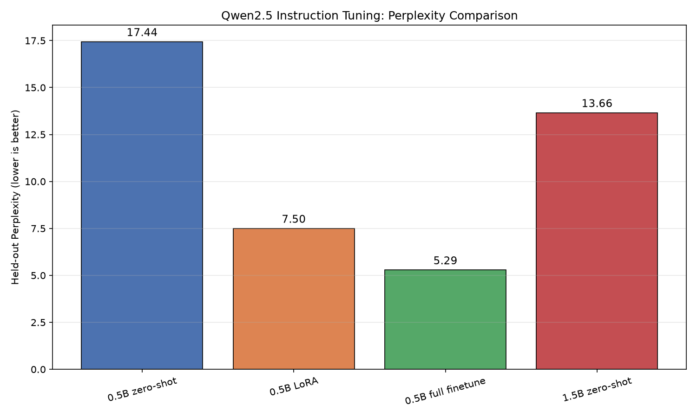
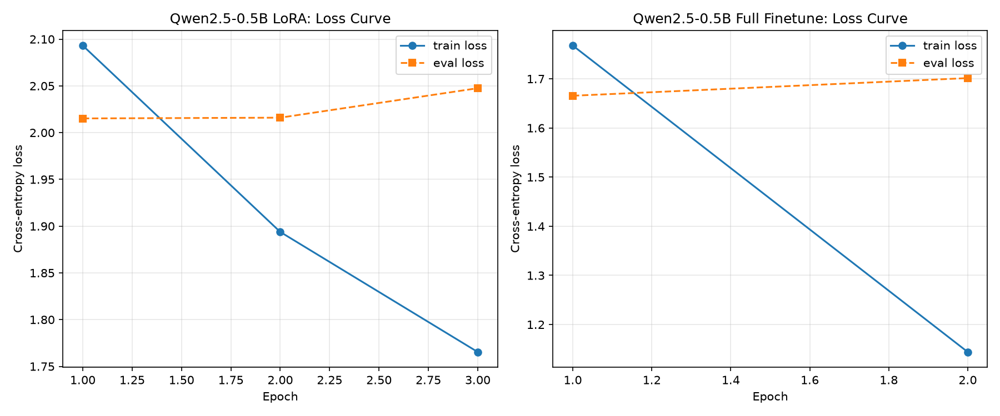

# Qwen2.5 LoRA 指令微调：与全量微调、零样本基线的对比实验

中文指令微调对比实验：**Qwen2.5-0.5B**（LoRA / 全量微调 / 零样本基线）与 **Qwen2.5-1.5B**（零样本基线），在 alpaca-gpt4-data-zh 上评估 held-out 困惑度（PPL）。

## TL;DR

| 方案 | Held-out PPL | 备注 |
|------|-------------:|------|
| 0.5B zero-shot | 17.44 | 未微调基线 |
| 0.5B LoRA | **7.50** | 仅训 0.88% 参数 |
| 0.5B full finetune | **5.29** | 100% 参数 |
| 1.5B zero-shot | 13.66 | 模型规模带来的零样本提升 |

- LoRA 相比零样本基线将 PPL 从 17.44 降到 7.50（约 **2.3×** 改善）
- 全量微调进一步降到 5.29，但训练参数量是 LoRA 的 ~500×
- 1.5B 零样本（13.66）优于 0.5B 零样本（17.44），模型规模对零样本能力有正向作用
- 两种微调方式都在 epoch 1 就达到最佳 eval loss，之后轻微过拟合

## 数据集

- alpaca-gpt4-data-zh（48k 中文 GPT-4 指令样本）
- 实验使用 5000 条训练 / 200 条 held-out 评估
- 自动下载脚本见 [download_data.py](code/download_data.py)

## 模型

- [Qwen/Qwen2.5-0.5B](https://huggingface.co/Qwen/Qwen2.5-0.5B)
- [Qwen/Qwen2.5-1.5B](https://huggingface.co/Qwen/Qwen2.5-1.5B)

## 环境与依赖

``
torch>=2.1, transformers>=4.40, peft>=0.11, datasets, accelerate, matplotlib
``

参见 [requirements.txt](requirements.txt)。

## 快速开始

``
# 1. 下载数据
python code/download_data.py

# 2. 下载模型（首次运行 transformers 会自动下载；也可用 huggingface-cli）
huggingface-cli download Qwen/Qwen2.5-0.5B --local-dir hf_cache/Qwen2.5-0.5B
huggingface-cli download Qwen/Qwen2.5-1.5B --local-dir hf_cache/Qwen2.5-1.5B

# 3. 零样本评估
python code/eval_lora.py --model hf_cache/Qwen2.5-0.5B --data datasets/alpaca_gpt4_data_zh.json --n_eval 200 --output output_05/zero_eval.json

# 4. LoRA 微调
python code/train_lora.py --model hf_cache/Qwen2.5-0.5B --data datasets/alpaca_gpt4_data_zh.json --mode lora --dtype bf16 --epochs 3 --output output_05_lora

# 5. 全量微调
python code/train_lora.py --model hf_cache/Qwen2.5-0.5B --data datasets/alpaca_gpt4_data_zh.json --mode full --dtype bf16 --epochs 2 --lr 5e-5 --output output_05_full

# 6. 可视化
python code/plot_lora.py
``

完整中文文档见 [docs/](docs/)：方案说明、环境搭建、操作步骤、实验报告、代码说明。

## 关键结论

1. **LoRA 是高效替代方案**：0.88% 可训练参数即可将 PPL 降至 7.50，相比零样本降低 2.3×
2. **全量微调增益有限**：PPL 从 7.50 降到 5.29（约 1.4×），代价是 ~500× 训练参数
3. **模型规模有效但需注意训练成本**：1.5B 零样本优于 0.5B 零样本
4. **数据规模很快饱和**：5000 样本下 epoch 1 即最优，epoch 2-3 轻微过拟合

## 实验限制

- 评估样本仅 200 条（held-out PPL 的统计波动较大）
- 训练使用 5000 样本子集（非完整 48k）
- 未完成 1.5B LoRA 微调（因硬件限制：8GB 显存 + 训练过程中断）
- 未做下游任务评估（仅困惑度）

## License

MIT. 详见 [LICENSE](LICENSE).

## 作者

李茂华 (@LiMaoHuaScheen) — 研究生申请项目 2026