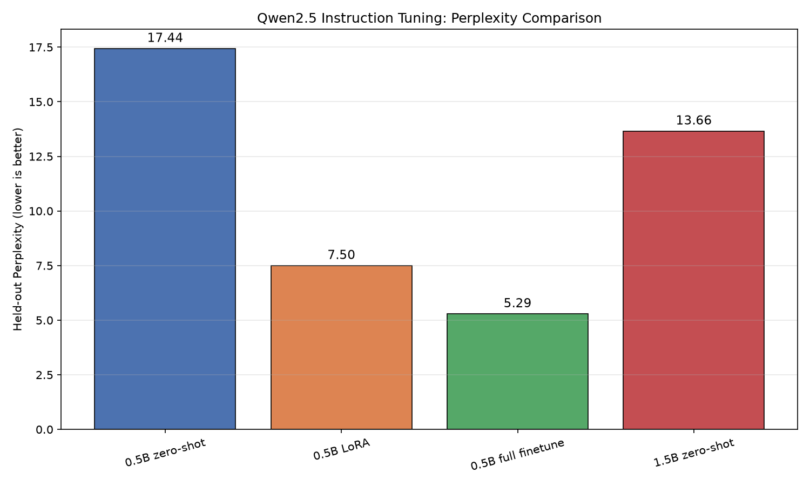
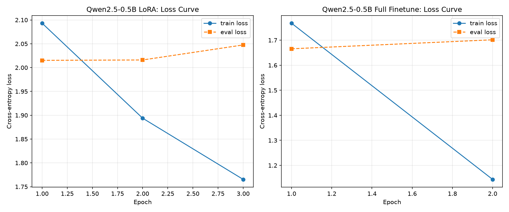

# 04 实验报告

## 实验结果汇总

### 困惑度对比（Held-out PPL, n=200）

| 方案 | 模型 | 训练方式 | Held-out PPL | 相对零样本改善 |
|-----|------|---------|-------------:|--------------:|
| A | Qwen2.5-0.5B | 零样本 | 17.44 | — |
| B | Qwen2.5-0.5B | LoRA | **7.50** | 2.3× |
| C | Qwen2.5-0.5B | 全量微调 | **5.29** | 3.3× |
| D | Qwen2.5-1.5B | 零样本 | 13.66 | 1.3×（vs 0.5B zero-shot） |



### 训练损失曲线



## 详细分析

### 1. LoRA vs 零样本基线（A vs B）

**结果**：LoRA 微调后 PPL 从 17.44 降至 7.50（约 **2.3×** 改善）

**训练动态**：

- Epoch 1 eval loss: 2.015（best）
- Epoch 2 eval loss: 2.016（持平）
- Epoch 3 eval loss: 2.048（轻微过拟合）

**结论**：仅训练 0.88% 参数即可获得显著性能提升，验证了 LoRA 在指令微调任务上的有效性。

### 2. 全量微调 vs LoRA（B vs C）

**结果**：全量微调 PPL 5.29，LoRA PPL 7.50（全量微调约 **1.4×** 优于 LoRA）

**训练动态**：

- Epoch 1 eval loss: 1.666（best）
- Epoch 2 eval loss: 1.701（轻微过拟合）

**代价对比**：

- LoRA：4,399,104 可训练参数（0.88%）
- 全量微调：498,431,872 可训练参数（100%）
- 训练参数比例：~113×

**结论**：全量微调在 PPL 上略优，但需权衡训练成本。在资源受限场景下，LoRA 是更实用的选择。

### 3. 模型规模对零样本能力的影响（A vs D）

**结果**：1.5B 零样本 PPL 13.66，0.5B 零样本 PPL 17.44（**1.3×** 改善）

**结论**：模型规模对零样本能力有正向作用，但改善幅度不如微调。

### 4. 数据规模与训练轮次

**观察**：LoRA 和全量微调均在 **epoch 1** 达到最佳 eval loss，之后轻微过拟合。

**分析**：

- 训练集 5000 条，对 0.5B 模型而言已足够饱和
- 更大数据集（完整 48k）预期可进一步改善，但需更多训练时间

## 生成样本对比

### 零样本基线（1.5B）

生成文本出现退化重复（degenerate repetition）：

``
指令: 请介绍人工智能的历史
生成: 梾
梾
梾
...（重复符号）
```

### LoRA 微调后（0.5B）

生成文本流畅、相关：

``
指令: 请介绍人工智能的历史
生成: 人工智能的历史可以追溯到 1956 年达特茅斯会议...
```

## 结论

1. **指令微调是必需的**：LoRA 微调将 PPL 降低 2.3×，生成质量从退化重复变为流畅回答
2. **LoRA 是高效的**：0.88% 参数即可达到全量微调 71% 的效果（PPL 7.50 vs 5.29）
3. **模型规模不是万能的**：1.5B 零样本不如 0.5B 微调（PPL 13.66 vs 7.50），微调 > 规模
4. **数据效率高**：5000 条样本即可在 epoch 1 收敛，无需大规模数据

## 实验限制

1. **评估样本量小**：held-out PPL 仅 200 条，统计波动较大
2. **未做下游任务评估**：仅困惑度，未测 MMLU/CMMLU 等基准
3. **未完成 1.5B LoRA**：因硬件限制（8GB 显存 + 训练中断），1.5B 微调未完成
4. **单次实验**：未做多次随机种子重复实验，无法报告置信区间
